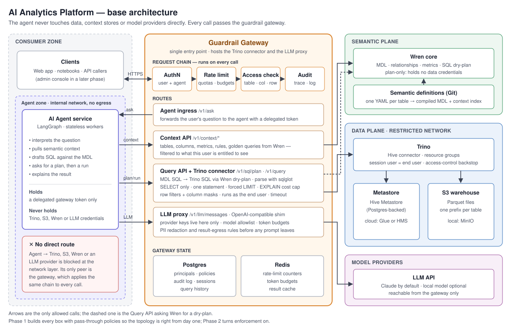

# ai_analytics_platform

Redefine analytics workflows using AI.

An AI analytics platform on an S3 warehouse of Parquet tables, queried with Trino and described by a semantic layer built on Wren core. An AI agent uses that layer to understand the data and turn natural-language questions into SQL. It never touches the data or a model provider directly: every data, context and LLM call goes through a guardrail gateway that handles authentication, access control, rate limiting and audit.

## Documents

- [Architecture](docs/architecture.md): components, design rules, the question-to-answer flow, identity, and local versus cloud setup
- [Capabilities plan](docs/capabilities-plan.md): what each base component must do, by phase, with exit criteria

## Phases

0. Foundations: repo, local stack, sample data, Wren spike
1. Data and semantics: MinIO or S3, Trino, semantic definitions, Wren core, gateway skeleton, agent v0, evals
2. Guardrails enforced: auth, access control, rate limiting, query guard, LLM controls, audit
3. Management in the product: semantic-definition and guardrail management
