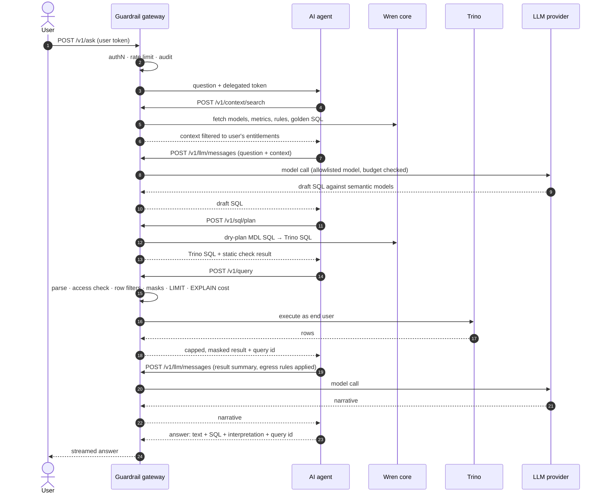

# Architecture — base platform

Status: draft for review · 2026-10-12

This document describes the base architecture of the AI Analytics Platform: an S3 data warehouse of Parquet tables, queried through Trino, described by a semantic layer built on Wren core, and used by an AI agent for data understanding and natural-language-to-SQL. Everything the agent does goes through a guardrail gateway.

Product features (KPI monitoring, reports, feeds, RCA and so on) are out of scope here; they build on these components in later phases. See [capabilities-plan.md](capabilities-plan.md) for what each component must do and in which phase.


## 1. Rules the design must keep

These hold in every phase. A change that breaks one of them needs an explicit decision record.

1. **The agent has one peer: the gateway.** It has no network route to Trino, the object store, the metastore, Wren or any LLM provider, and it holds none of their credentials.
2. **All data access is a gateway call.** The gateway hosts the only Trino client. It runs read-only, policy-checked SQL as the end user.
3. **All LLM calls are gateway calls.** Provider keys live only in the gateway. This includes LLM or embedding calls made by third-party components such as Wren.
4. **Context is filtered by entitlement.** The agent (and so the LLM) only learns about tables, columns and sample values the user is allowed to see.
5. **Every call carries two identities**: the end user and the calling agent or service, plus a trace id. Every call is audited.
6. **Semantic definitions are code.** One reviewed source per table compiles to the Wren MDL and the context index; nothing is edited directly in a running service.
7. **Enforcement does not depend on prompts.** Access, limits and redaction are applied by code in the gateway (and Trino as a backstop), never by instructions to the model.

## 2. Components

### 2.1 Data plane

| Component | Role | Local | Cloud |
|---|---|---|---|
| Object store | Holds Parquet files, one prefix per table (`s3://warehouse/<schema>/<table>/`), Hive-style partitions where useful | MinIO | Amazon S3 |
| Metastore | Maps table names to S3 locations, schemas and partitions | Hive Metastore on Postgres | AWS Glue Data Catalog or Hive Metastore |
| Trino | SQL engine over the Parquet tables via the Hive connector (catalog `lake`). Resource groups separate interactive and background work. File-based access control as a backstop to the gateway | Single coordinator-worker container | Coordinator plus autoscaled workers |

Table format: plain Parquet behind the Hive connector, because the warehouse is defined as Parquet files and needs no conversion. Iceberg (time travel, schema evolution, snapshot-pinned reports) can be added later as a second Trino catalog over the same bucket; that is a Phase 3 decision, not a base requirement.

The data plane sits on a restricted network. Only the gateway (and Wren, if the spike shows it needs metadata access) can reach Trino. Only Trino and the metastore can reach the object store.

### 2.2 Semantic plane

**Semantic definitions** live in Git under `semantic/`, one YAML file per table. Each file holds two parts:

- *Semantic definition* — what the table is, structurally: grain, primary key, columns with types and meanings, PII classes, relationships, metrics.
- *Context* — what an analyst would tell a newcomer: business rules, synonyms, caveats, known data issues, sample questions with verified SQL.

```yaml
# semantic/cards/transactions.yml
table: transactions
source: { catalog: lake, schema: cards, table: transactions }
description: One row per card transaction, posted or declined.
grain: one row per transaction_id
owner: payments-analytics
freshness: daily by 06:00 IST, partitioned by txn_date
primary_key: transaction_id

columns:
  - name: transaction_id
    type: varchar
    description: Unique id assigned by the card switch.
  - name: card_id
    type: varchar
    description: Card used. Joins to cards.card_id.
  - name: amount_inr
    type: decimal(18,2)
    description: Amount in INR, signed. Refunds are negative.
    semantic_type: currency
  - name: status
    type: varchar
    allowed_values: [POSTED, DECLINED, REVERSED]
  - name: customer_phone
    type: varchar
    pii: phone            # drives masking and LLM-egress rules

relationships:
  - name: transaction_card
    to: cards
    type: many_to_one
    on: transactions.card_id = cards.card_id

metrics:
  - name: total_spend
    expression: sum(amount_inr)
    filter: status = 'POSTED'
    description: Posted spend, net of refunds.

context:
  business_rules:
    - Spend never includes DECLINED or REVERSED transactions.
  synonyms:
    total_spend: [purchase volume, card spend, GMV]
  caveats:
    - merchant_category is null before 2024-01-01.
  sample_questions:
    - question: What was total spend last month by merchant category?
      sql: |
        SELECT merchant_category, sum(amount_inr) AS total_spend
        FROM transactions
        WHERE status = 'POSTED'
          AND txn_date >= date_trunc('month', current_date) - INTERVAL '1' MONTH
          AND txn_date <  date_trunc('month', current_date)
        GROUP BY 1
```

A build step (`semantic build`) validates every file against the live Trino schema, then compiles:

- the **Wren MDL** manifest (models, columns, relationships, metrics), and
- the **context index**: searchable documents for tables, columns, rules and sample questions.

**Wren core** serves the MDL and turns SQL written against semantic models into Trino SQL (dry-plan). It runs plan-only: it holds no Trino credentials and never executes queries. If Wren needs live metadata for validation, it gets a Trino service user limited to `information_schema` — confirmed in the Phase 0 spike.

If we later use Wren's own text-to-SQL pipeline or LangGraph SDK, its LLM and embedding base URL points at the gateway's OpenAI-compatible LLM endpoint, with a service identity that carries the originating user. Rule 3 holds either way.

### 2.3 Guardrail gateway

One service (Python, FastAPI) that is the only entry point for clients and the only exit point for the agent. Every request runs the same chain, then one route.

**Request chain**

| Step | Phase 1 (pass-through) | Phase 2 (enforced) |
|---|---|---|
| Authenticate | Fixed dev principal; token shape and propagation are real | JWT validation (OIDC-ready), service and agent credentials, delegated user tokens |
| Rate limit | Counters recorded, never blocking | Token buckets per user, agent and route; concurrent-query caps; daily LLM token budgets |
| Access check | Allow-all policy, but every decision is computed and logged | Table, column and row policies from the policy store; deny by default |
| Audit | Append-only log of every call, with trace id | Same, plus decision reasons, retention and export |

**Routes**

| Route | What it does | Backend |
|---|---|---|
| `POST /v1/ask` | Takes a user's question, mints a short-lived delegated token, forwards to the agent, streams the answer back | Agent service |
| `GET /v1/context/tables`, `GET /v1/context/tables/{name}`, `POST /v1/context/search` | Returns semantic definitions and context, with forbidden tables and columns removed | Wren core + context index |
| `POST /v1/sql/plan` | MDL SQL → Trino SQL via Wren, then static checks. Never executes | Wren core |
| `POST /v1/query` | Re-validates, applies policy, runs on Trino as the end user, returns capped and masked rows | Trino (the gateway's connector) |
| `POST /v1/llm/messages` (+ OpenAI-compatible shim) | Forwards model calls with model allowlist, budgets, redaction and result-egress rules | LLM providers |

**Query guard**, applied inside `/v1/query` before Trino sees anything:

1. Parse with sqlglot (Trino dialect). Reject anything but a single `SELECT` or `WITH … SELECT`.
2. Resolve every referenced table and column, including through views and `SELECT *` expansion.
3. Check them against the user's policy. Phase 2 adds row-filter injection and column masking.
4. Force a `LIMIT` (default 1,000 rows returned to the agent) and a statement timeout.
5. Run `EXPLAIN` and reject plans above the cost cap.
6. Execute through the Trino client with `user=<end user>`, the gateway's service credential, and the interactive resource group.

**State.** Postgres holds principals, policies, the audit log, sessions and query history. Redis holds rate-limit counters, token budgets and the result cache.

### 2.4 AI agent

A LangGraph service with no credentials of its own beyond the delegated token it receives per request. Its tools are thin HTTP clients to the gateway routes above: `search_context`, `describe_table`, `plan_sql`, `run_query`, `call_llm`. Phase 1 keeps conversation state in memory; durable state, when needed, is stored behind a gateway route rather than in a database the agent connects to.

It runs on a Docker network marked `internal`: no internet egress and no route to the data plane. The gateway is attached to both that network and the restricted network.

### 2.5 LLM providers

Claude is the default. Proposed routing, adjustable per environment in the gateway config:

| Task | Model |
|---|---|
| SQL drafting, multi-step reasoning | `claude-sonnet-5-5` |
| Question classification, short rewrites | `claude-haiku-5-5` |

A local model (for offline development) can be added as another provider behind the same proxy. The agent never chooses a provider endpoint, only a model alias the gateway allows.

## 3. Flow: question to answer



If planning or execution fails, the agent may repair and retry within a fixed budget (Phase 1: two retries), each retry a fresh gateway call. If the question is ambiguous or not answerable from the semantic layer, the agent says so instead of guessing.

## 4. Identity and trust

| Principal | Authenticates with | Can call |
|---|---|---|
| End user | User token (Phase 2: OIDC via the company IdP; locally Keycloak or the gateway's dev issuer) | `/v1/ask`, later product routes |
| Agent service | Service credential + per-request delegated token (short-lived, scoped to one user and one conversation) | Context, plan, query and LLM routes |
| Internal services (e.g. Wren, if it calls an LLM) | Service credential | LLM proxy only, tagged with the originating user |
| Admin | User token with admin role | Policy and audit routes (Phase 3 console) |

Access decisions are always made for the **end user**. The agent's identity narrows what it can do (which routes, which budgets) but never widens what the user can see.

Network zones:

| Zone | Members | Can reach |
|---|---|---|
| Consumer | Clients | Gateway |
| Agent (internal, no egress) | Agent service | Gateway |
| Gateway | Gateway, Postgres, Redis | Agent, semantic plane, data plane, LLM providers |
| Semantic | Wren core | Trino `information_schema` only, if needed |
| Data (restricted) | Trino, metastore, object store | Each other |

## 5. Local versus cloud

| Concern | Local (docker compose) | Cloud (AWS) |
|---|---|---|
| Object store | MinIO | S3 |
| Metastore | Hive Metastore + Postgres | Glue Data Catalog or Hive Metastore on RDS |
| Query engine | Trino, single node | Trino on EKS, or Starburst |
| Semantic engine | Wren core container | Same, on EKS |
| Gateway, agent | Containers | EKS services behind an ALB |
| State | Postgres, Redis containers | RDS Postgres, ElastiCache |
| Identity | Gateway dev issuer, Keycloak optional | Company IdP via OIDC |
| Secrets | `.env` (git-ignored) | AWS Secrets Manager |
| Network isolation | Docker networks, agent network `internal: true` | VPC subnets and security groups |

Swapping MinIO for S3 changes only Trino's and the metastore's S3 endpoint settings; the gateway, agent and semantic files are unchanged.

## 6. To confirm in the Phase 0 spike

The Product Review notes that Wren's open-source scope changed in May 2026: the maintained core is the MDL semantic layer, the text-to-SQL engine, an MCP server and a LangGraph SDK, while row and column security, users and audit are commercial-only. This design does not depend on any commercial feature, but these points need hands-on confirmation before Phase 1 locks in:

1. Wren core can dry-plan MDL SQL to Trino SQL without a data-source connection, or with metadata-only access.
2. The MDL covers what our YAML needs (metrics with filters, relationships, column descriptions); anything else stays in the context index.
3. How Wren's retrieval and memory (instructions, SQL pairs) compare with our own context index, and whether to use them.
4. The Hive connector on MinIO with a Postgres-backed Hive Metastore works with the pinned Trino version.
5. sqlglot's Trino dialect parses everything Wren's dry-plan emits.
